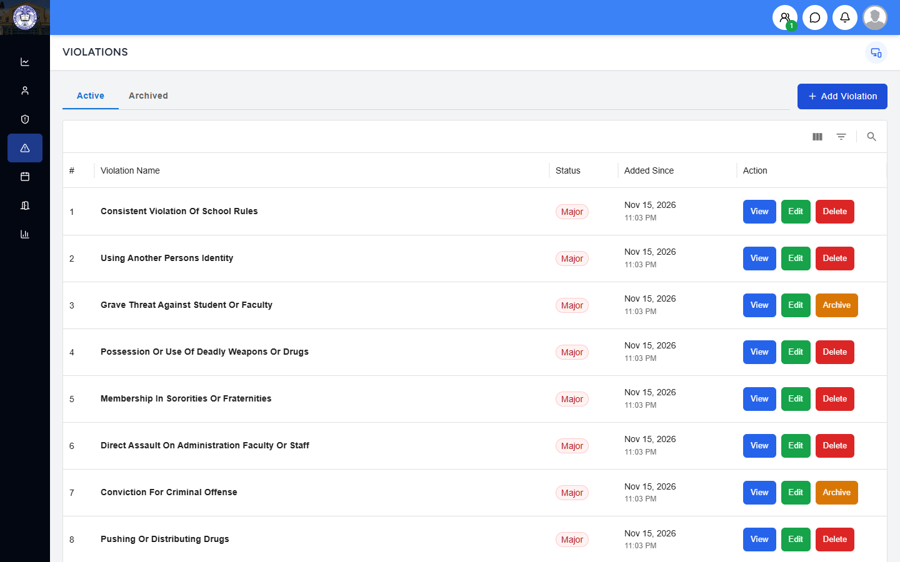
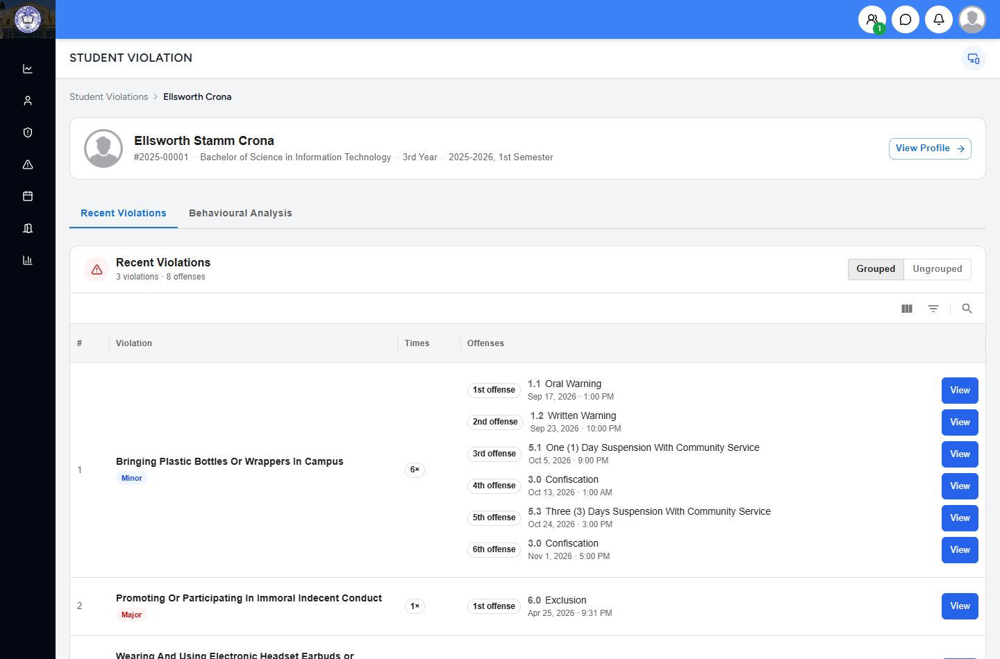
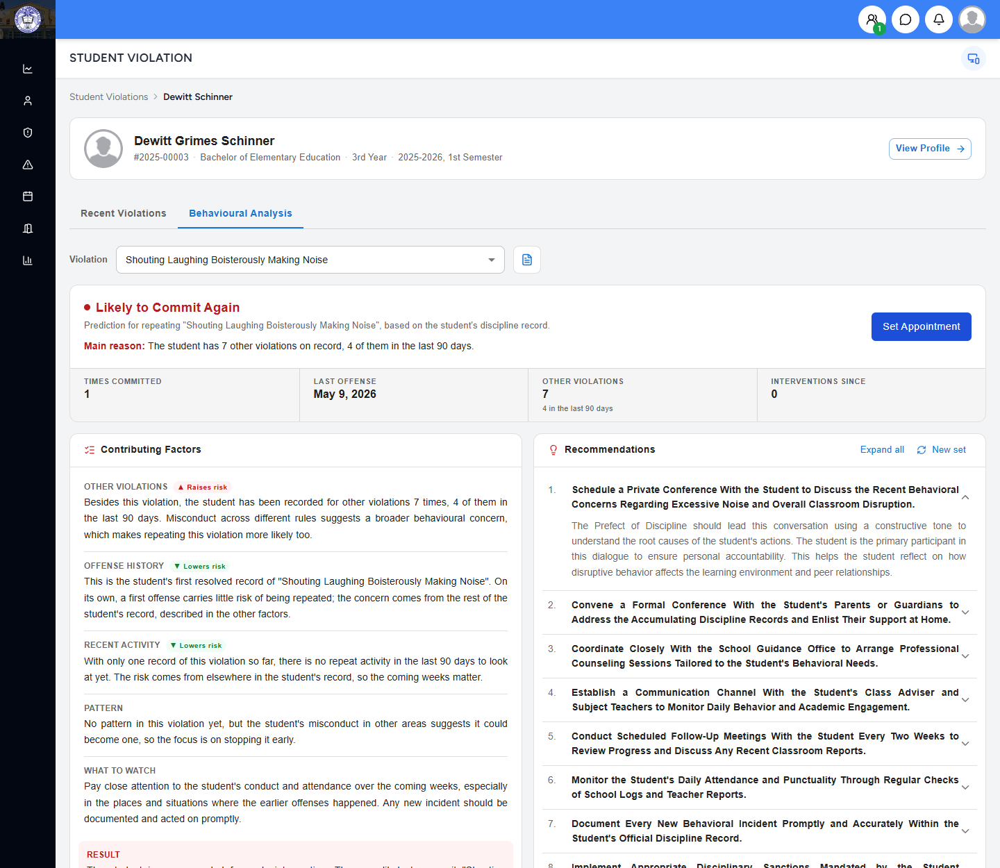
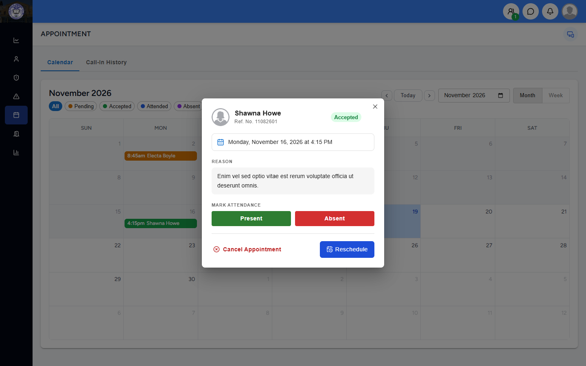
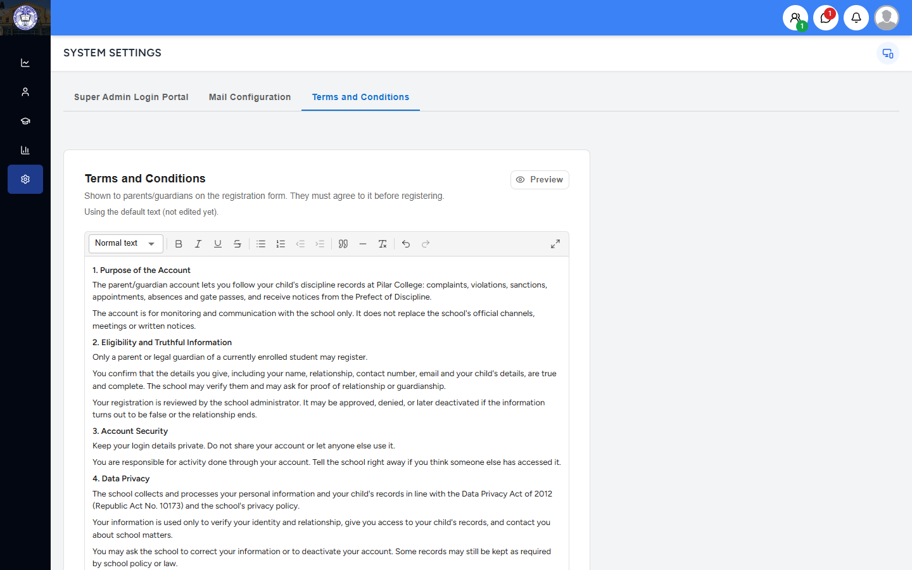
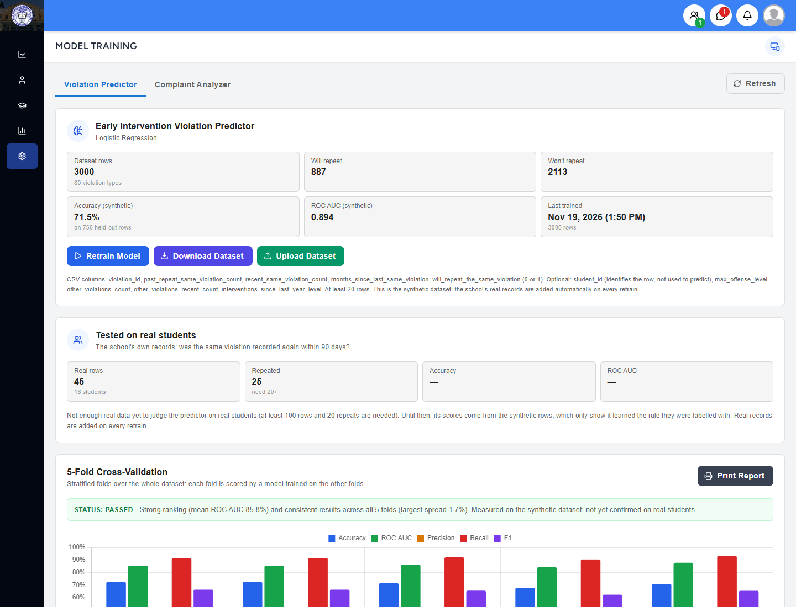
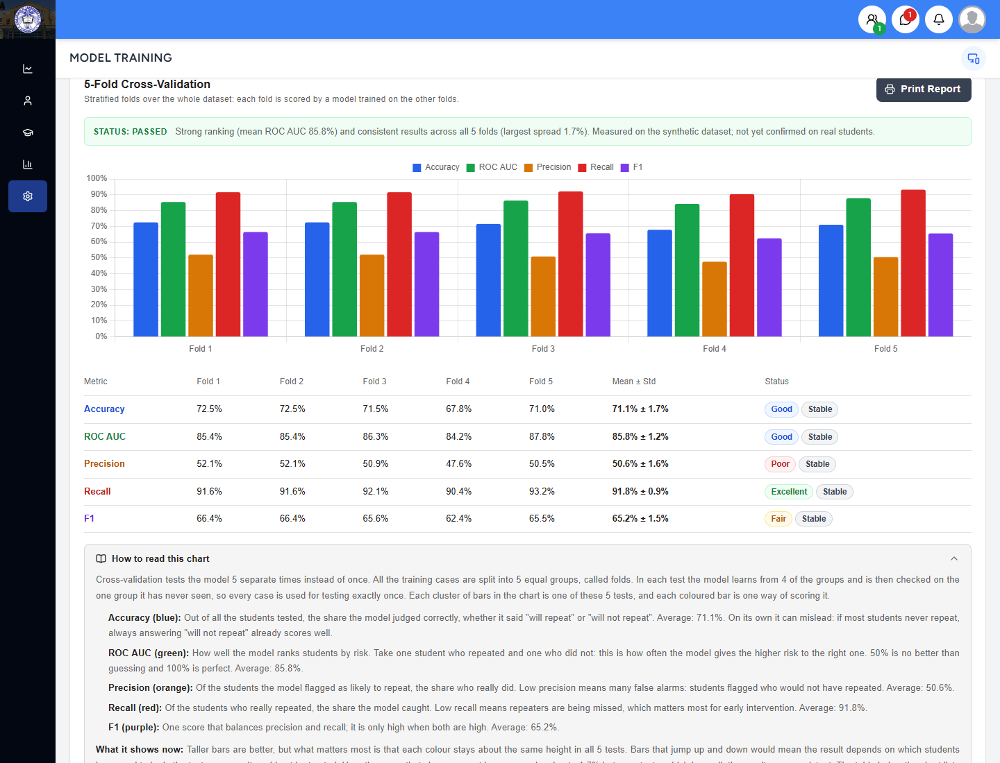
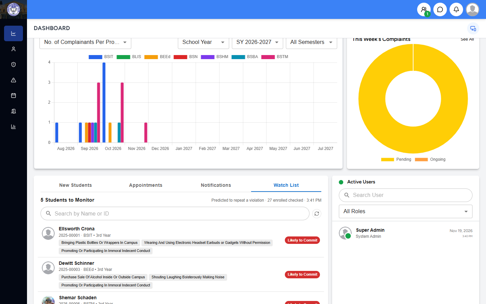
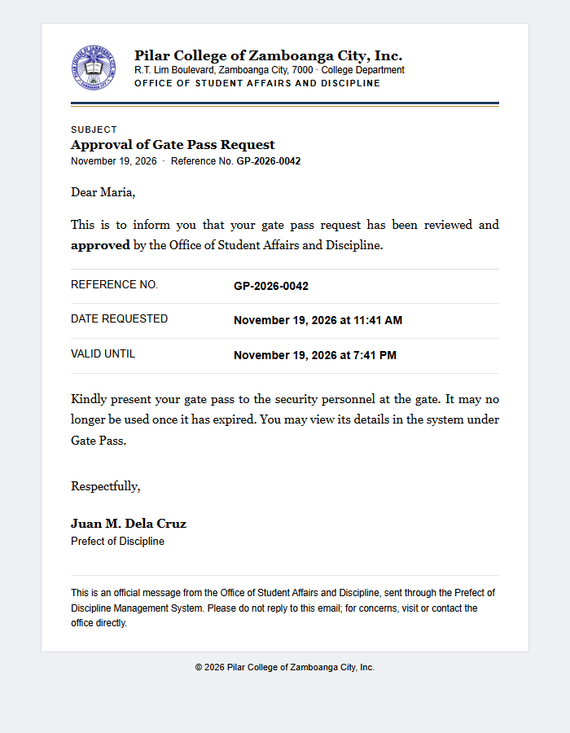
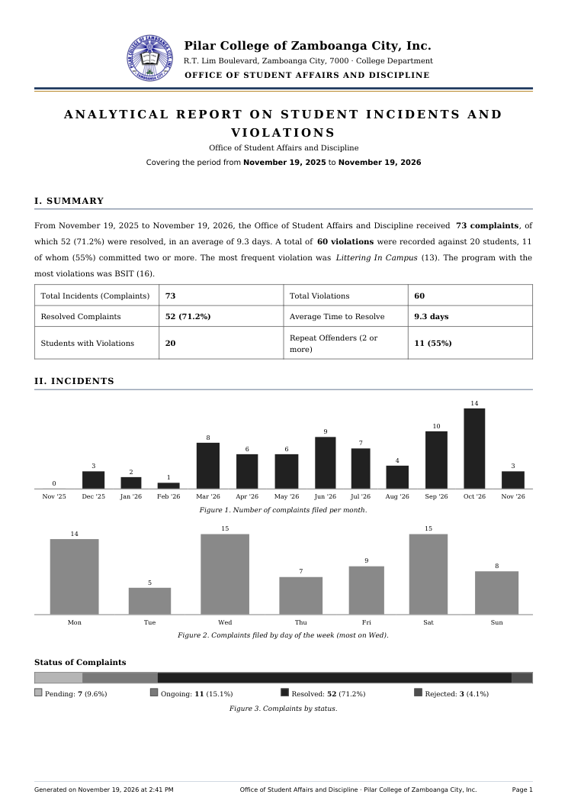

# PilarPODHEDMS

**Pilar Prefect of Discipline of the Higher Education Department Management System**

> 🚧 **Status: Under Development.** PilarPODHEDMS is still actively being built and refined. Features, modules, and workflows described in this document may change, and some functionality may not yet be fully implemented or stable.

## About the System

PilarPODHEDMS is a centralized management system designed to support and streamline the monitoring, documentation, processing, and management of student discipline-related records and activities within the Higher Education Department. The system provides a structured platform for the Prefect of Discipline and authorized personnel to manage various student-related cases and transactions, including complaints, referrals, absent forms, violations, appointments, call-ins, and gate passes.

PilarPODHEDMS provides a centralized repository for student discipline-related information, allowing authorized personnel to efficiently record, monitor, update, retrieve, and manage records. It also includes an archival mechanism for preserving historical records and documents for future reference, monitoring, verification, and reporting.

In addition to its management and record-keeping functions, PilarPODHEDMS incorporates Machine Learning components — including a Natural Language Processing (NLP) technique — to provide decision-support features:

- A **Logistic Regression** model analyzes a student's historical violation records and classifies whether the student is likely or unlikely to commit the same type of violation again.
- A **Word2Vec**-based text analysis component analyzes the context of the reason provided in a complaint and identifies potentially related violations by comparing the complaint with the available violation list.

> These AI-assisted features are designed to provide supplementary information to authorized personnel and do not automatically determine disciplinary actions, sanctions, case classifications, or case outcomes.

PilarPODHEDMS integrates student discipline management, incident and transaction processing, record keeping, archival management, notifications, reporting, natural language processing, and predictive analytics into a single platform — providing a structured approach to the management of higher education student discipline records and activities.

## Table of Contents

- [System Modules](#system-modules)
- [Artificial Intelligence and Machine Learning Components](#artificial-intelligence-and-machine-learning-components)
- [Documents and Emails](#documents-and-emails)
- [Archival Management](#archival-management)
- [Key Features](#key-features)
- [System Workflow](#system-workflow)
- [Purpose of the System](#purpose-of-the-system)
- [Intended Users](#intended-users)
- [Messaging Rules](#messaging-rules)
- [Privacy and Security](#privacy-and-security)
- [Scheduled Tasks](#scheduled-tasks)
- [Technology](#technology)
- [Getting Started (Local Development)](#getting-started-local-development)
- [AI/ML Data Flow](#aiml-data-flow)
- [Disclaimer](#disclaimer)

## System Modules

### 1. User Module

The User Module manages the users who interact with PilarPODHEDMS. It handles user accounts, authentication, user information, roles, and access permissions, ensuring that users can access the functions and information appropriate to their assigned roles.

**Main Functions**

- User account management
- User authentication
- Role management
- Access control
- User information management
- Account status management
- User activity management
- Password recovery with a 6-digit verification code sent by email
- Parent/guardian registration, with Terms and Conditions the parent must agree to

### 2. Incident Module

The Incident Module manages student discipline-related incidents and cases. It covers the recording and processing of complaints, referrals, and absent forms.

The module allows authorized personnel to record incidents, review submitted information, monitor case status, and maintain historical records. It also supports the archival of completed or previous incident records for future reference.

The Incident Module integrates the Word2Vec-based text analysis component to assist authorized personnel in identifying potentially related violations based on the reason or description provided in a complaint.

The Prefect of Discipline can file a complaint or referral on someone's behalf (for example, for a student or an outside complainant), and can issue absent forms and gate passes directly. In each case the system records which prefect filed it, shown as **"Filed By (Prefect)"** in the prefect's tables and on the record itself. Pending complaints can be approved in bulk.

A rejected referral or absent form can still be approved later (for example, when more evidence comes in); its rejection stays on record. Each record's view shows a timeline of every step it goes through, including the steps still ahead.

**Resolving a complaint.** When the Prefect resolves a complaint, the system checks the input first: every subject must be a student, each student needs at least one violation (or "none"), a violation can't be listed twice, and archived violations can't be chosen. The reason is shown if anything is wrong.

**Sending a referral.** The Prefect can send a referral to the **Guidance** office or to **IT Staff**. The referral form is built as a PDF when it is sent (it is not stored), emailed to that office and opened for the Prefect. The receiving office can add one **note** to the referral; a saved note is final. Each office only sees the referrals actually sent to it.

**Main Functions**

- Complaint management
- Referral management
- Absent form management
- Approving a previously rejected referral or absent form
- Sending a referral to Guidance or IT Staff, with the office's note
- Filing on behalf of a complainant or referrer (tracked per prefect)
- Bulk approval of pending complaints
- Incident recording
- Incident monitoring
- Case status management
- Incident archiving
- Complaint context analysis
- Related violation identification

### 3. Violation Module

The Violation Module manages the different violation types and student violation records maintained by the system. It allows authorized personnel to document violations committed by students and maintain their disciplinary history.

The module also serves as an important source of data for the system's AI/ML components. Historical violation records are used by the Logistic Regression model to classify whether a student is likely or unlikely to commit the same type of violation again. The violation list also serves as a reference for the Word2Vec component when analyzing complaint descriptions and identifying potentially related violations.

Violation Management is a group of pages:

| Page | What it does |
| --- | --- |
| **Violations** | The violation list — each with its keywords (picked from existing keywords or newly added) and its penalty for each offense level (1st to 6th offense). |
| **Penalties** | The penalty list with its handbook reference numbers (e.g. 1.1 Oral Warning). |
| **Student Violations** | Students with resolved violations, their total violations and how many violations they have **repeated** (prefect only). |



A student's violation page has two tabs:

- **Recent Violations** — the student's offenses, either **grouped** (each violation once, with every offense, its penalty and date) or **ungrouped** (one row per offense, newest first). Each offense opens the complaint behind it.
- **Behavioural Analysis** — for the chosen violation:
  - a **verdict** ("Likely to Commit Again" / "Unlikely to Commit Again") with its **main reason** in one sentence about the student's record, and key facts (times committed, last offense, other violations, interventions since the last offense);
  - **Contributing Factors**, each marked as raising or lowering the risk, strongest first;
  - **Recommendations** written by Google Gemini, which the Prefect can replace with a new set;
  - the **Violation Timeline** with each offense's penalty;
  - a formal **Behavioural Analysis Report** (PDF).





**Main Functions**

- Violation list management
- Penalty ladder per offense level, with reference numbers
- Violation recording
- Student violation history
- Repeated violation tracking
- Violation monitoring
- Violation classification
- Violation record archiving
- Data preparation for predictive analysis
- Reference data for complaint analysis

### 4. Appointment Module

The Appointment Module manages appointments between students and the Prefect of Discipline or other authorized personnel. It provides a structured process for scheduling and maintaining appointment records, allowing authorized personnel to monitor scheduled appointments and their corresponding status.

The prefect can also set an appointment straight from a student's violation page when the model flags the student as likely to repeat a violation (an early-intervention consultation). Students are reminded of upcoming appointments automatically (see [Scheduled Tasks](#scheduled-tasks)).

From the calendar, the Prefect opens an appointment to see the student, date, reason and status, mark the student **present** or **absent**, **reschedule** or **cancel** it. Call-ins (office calls) are kept as records too and listed in the **Call-In History** tab.



**Related violations.** An appointment, a call-in or a referral can be linked to one or more of the student's violations (**Related violation(s)**, picked from the violations on the student's record, each shown with how many times and when last). Linked interventions count toward the repeat-violation model's data for those violations; see [Logistic Regression](#1-logistic-regression--repeat-violation-prediction).

**Main Functions**

- Appointment creation
- Appointment scheduling
- Early-intervention appointments from the violation page
- Attendance marking (present / absent)
- Call-in records and history
- Linking appointments, call-ins and referrals to the violations they address
- Automatic appointment reminders
- Appointment monitoring
- Appointment status management
- Appointment history
- Appointment record keeping

### 5. Gate Pass Module

The Gate Pass Module manages student gate pass requests and records. It provides a centralized process for recording, monitoring, and managing gate pass transactions.

Students are notified automatically before an approved gate pass expires, and expired gate passes are archived on their own.

**Main Functions**

- Gate pass requests
- Gate pass issuing by the prefect
- Automatic expiry reminders
- Gate pass recording
- Gate pass monitoring
- Gate pass status management
- Gate pass history
- Gate pass record keeping

### 6. Notification Module

The Notification Module manages system-generated notifications and updates. It provides users with relevant information regarding incidents, appointments, requests, and other system activities, helping ensure that users are informed of important updates and actions that require their attention.

Notifications appear live (through Laravel Reverb). Scheduled reminders are sent in batches through the queue. Notification links carry encrypted ids, and a user can only ever open their own notifications.

Important updates are also sent by email in a formal letter format (see [Documents and Emails](#documents-and-emails)).

**Main Functions**

- System notifications
- Live (real-time) notifications
- Scheduled reminders (appointments, gate pass expiry)
- Incident-related notifications
- Appointment notifications
- Request updates
- Status notifications
- Notification history

### 7. Report Module

The Report Module provides tools for generating reports based on information stored within the system. It allows authorized personnel to review and summarize discipline-related records for documentation, monitoring, and administrative purposes.

Reports is a group of pages. For the prefect: **Incident**, **Violation**, **Tardy**, **Appointment** and **Gate Pass** reports, an **Analytical Report**, **Saved Filters** and **Generated Reports**. For the IT admin: **Statistics** and **Action Log**.

Each report page has three tabs:

| Tab | What it shows |
| --- | --- |
| **Records** | The report's records, filtered by date range or school year/semester. |
| **Statistics** | Totals and charts for those same records (e.g. by type, by program, by month). |
| **Generate Report** | That report type's saved filters, each ready to generate as a PDF or Excel file. |

Saved filters are created and managed on the Saved Filters page. Generated files are queued and listed on the Generated Reports page for viewing and download. All PDF reports share a formal layout (see [Documents and Emails](#documents-and-emails)).

**Main Functions**

- Incident reports
- Violation reports
- Student disciplinary history
- Appointment reports
- Gate pass reports
- Statistical summaries
- Record-based reporting
- Historical record reporting
- Saved report filters
- Queued PDF / Excel report generation

### 8. System Administrator Module

The System Administrator Module manages system-level configuration, maintenance, and administrative functions. It provides authorized system administrators with tools for managing system settings, user access, configurations, and other requirements necessary for the proper operation and maintenance of PilarPODHEDMS.

**System Settings** has three tabs: the super admin **login portal** password (used during maintenance), the **mail configuration** (with a test email), and the parent/guardian **Terms and Conditions**, edited in a rich-text editor with a preview. Each saved version of the terms is kept, so a registration records the exact version the parent agreed to.



The **Model Training** page covers the two AI/ML models:

- **Violation Predictor** — its dataset, retraining and dataset upload/download; how it does on **real students**; its 5-fold cross-validation (with a pass/fail **status** and a rating per metric), confusion matrix, ROC curve and calibration, each with a plain-language **"How to read this chart"** explanation; and **Insights** that explain the results in practice. The evaluation can be printed as a formal report.
- **Complaint Analyzer** — rebuilding the violation embeddings and testing it with sample complaint text.





**Main Functions**

- System configuration
- User and role administration
- AI/ML model training and evaluation
- Parent/guardian Terms and Conditions
- Mail configuration
- Access management
- System settings
- Maintenance functions
- Administrative controls
- System monitoring
- System data management

## Artificial Intelligence and Machine Learning Components

PilarPODHEDMS incorporates two AI/ML-based components that serve different purposes in student discipline management:

```
                         PilarPODHEDMS
                              │
                     AI / ML COMPONENTS
                              │
                 ┌────────────┴────────────┐
                 │                         │
          Logistic Regression           Word2Vec
                 │                         │
         Violation History        Complaint Reason/Context
                 │                         │
                 ▼                         ▼
       Repeat Violation Prediction   Context Analysis
                 │                         │
                 ▼                         ▼
      Likely to Commit /           Related Violations
      Unlikely to Commit           from Violation List
```

### 1. Logistic Regression — Repeat Violation Prediction

The Logistic Regression model is used to analyze a student's historical violation records and classify whether the student is likely to commit or unlikely to commit the same type of violation again.

The model uses previously recorded violation information to identify patterns associated with repeated violations. After analyzing the available historical records, the system generates a binary classification result.

**What it looks at.** For a student and a violation, the model uses:

| Input | Meaning |
| --- | --- |
| Times committed | How many times the student has committed this violation |
| Recent offenses | How many of those were in the last 90 days |
| Time since the last offense | Months since the latest one (a first offense is marked separately) |
| Penalty level | How far along the violation's penalty ladder the student is |
| Other violations | The student's other violations, in total and in the last 90 days |
| Interventions | Appointments attended, referrals approved and call-ins linked to this violation since its last offense |
| Year level | The student's year level |

**When a student is flagged.** Missing a student who goes on to repeat a violation is worse for early intervention than an unneeded check-in, so the cut-off for "Likely to Commit" is tuned on every retrain to favour catching repeaters (it counts catching a repeater twice as much as avoiding a false alarm). The risk percentages themselves are not changed by this.

**Prediction Outputs**

| Output                       | Meaning                                                                                                                                                                      |
| ---------------------------- | ---------------------------------------------------------------------------------------------------------------------------------------------------------------------------- |
| **Likely to Commit**   | Based on the available historical violation records and the patterns learned by the model, the student is classified as likely to commit the same type of violation again.   |
| **Unlikely to Commit** | Based on the available historical violation records and the patterns learned by the model, the student is classified as unlikely to commit the same type of violation again. |

**General Process**

```
Student Violation Records
          │
          ▼
Historical Data Preparation
          │
          ▼
Logistic Regression Model
          │
          ▼
   Pattern Analysis
          │
          ▼
 Binary Classification
          │
       ┌──┴───┐
       │      │
       ▼      ▼
    Likely  Unlikely
   to Commit to Commit
```

The prediction is intended to provide supporting information for authorized personnel when monitoring students with previous violation records. It does not automatically determine whether a student will commit a future violation and does not independently impose disciplinary action.

**Watch List.** The prefect's dashboard has a **Watch List** of currently enrolled students whom the model classifies as likely to repeat a violation, highest probability first. Each entry links to the student's Behavioural Analysis for that violation. The list is scored in one batch request and cached for a few minutes.



**Training data.** The model learns from two sources:

1. **Real records.** Each time the Prefect resolves a complaint, the student's record for each of its violations is saved as a training row. Once 90 days have passed (plus a 30-day grace period for late resolutions), the row is labelled with what actually happened: was the same violation recorded again? Interventions linked to the violation are counted up to that point. These rows are kept even after the complaint itself is archived and purged.
2. **Generated records** that follow the school's own violation rules, used while the real history is still small.

The model is retrained every day at 08:00 with the latest real records. The Model Training page reports its results on the generated data and, separately, on **real students it never trained on**, once there are at least 100 real cases and 20 repeats.

> While the real history is still small, the model's results come mostly from the generated data and should be read as guidance alongside the Prefect's own judgment.

### 2. Word2Vec — Complaint Context and Related Violation Identification

PilarPODHEDMS also incorporates Word2Vec, a Machine Learning technique used for Natural Language Processing (NLP), for analyzing the textual content of a complainant's reason or description.

Word2Vec represents words as numerical vectors based on their contextual relationships. In PilarPODHEDMS, this capability is used to analyze the context of a complaint and compare it with the descriptions or contextual information associated with the violations maintained in the system.

When a complaint is submitted, the system processes the complainant's reason and analyzes its semantic context. The resulting representation is compared with the available violation list to identify potentially related violations or incidents.

**General Process**

```
     Complaint Reason
            │
            ▼
      Text Processing
            │
            ▼
Word2Vec Context Analysis
            │
            ▼
Semantic Similarity Comparison
            │
            ▼
 System Violation List
            │
            ▼
Potentially Related Violations
            │
            ▼
Displayed to Authorized Personnel
```

**Example**

A complaint may contain a reason such as:

> "The student threatened another student during an argument."

The system analyzes the context of the complaint and compares it with the available violation list. Based on the semantic similarity between the complaint and the violation descriptions, the system may identify potentially related violations such as:

- Threatening
- Harassment
- Bullying
- Physical Altercation
- Other related violations

The displayed results serve as possible related violations for reference and do not automatically determine the final classification or outcome of the complaint.

### AI/ML Component Comparison

| Component                     | Purpose                                                   | Input                                               | Output                                   |
| ----------------------------- | --------------------------------------------------------- | --------------------------------------------------- | ---------------------------------------- |
| **Logistic Regression** | Predict potential repeat violation                        | Student's historical violation records              | Likely to Commit / Unlikely to Commit    |
| **Word2Vec**            | Analyze complaint context and identify related violations | Complainant's reason/description and violation list | Potentially related violations/incidents |

The two components perform different functions within PilarPODHEDMS. Logistic Regression focuses on predicting whether a student is likely or unlikely to repeat the same violation based on historical records, while Word2Vec focuses on understanding the contextual similarity of complaint descriptions and identifying potentially related violations from the system's violation list.

## Documents and Emails

**PDF documents.** Record documents (complaint, referral, absent form, behavioural analysis) and every report share a formal layout: the school letterhead, a centered title, numbered sections, plain bordered tables and black text.

**Emails.** System emails use a formal letter layout: the school letterhead and logo, a subject line with the date and the record's **reference number** (gate passes, absent forms and referrals), the letter itself, the Prefect's signature where it applies, and a short footer. The approved absent form is attached as a PDF, and a referral sent to an office carries the referral form.

| Email | Sent when |
| --- | --- |
| Verification code | A user recovers their password or confirms a password change |
| Office call | The Prefect calls a student in |
| Gate pass | A gate pass is approved, issued or not approved |
| Absent form | An absent form is approved |
| Appointment | An appointment is scheduled (sent to the parent) |
| Referral | A referral is sent to Guidance or IT Staff |
| Parent account / registration | A parent's account is created, their registration is not approved, or they confirm their registration |

<p>
  
  
</p>

## Archival Management

PilarPODHEDMS includes an archival mechanism for preserving historical discipline-related records and documents.

Archived records may include previously processed incidents and other applicable disciplinary documents. The archival feature helps maintain historical information for future reference, record verification, monitoring, reporting, and potential data analysis.

The archive provides a separate means of preserving records without removing their historical information from the system.

## Key Features

- Student user management
- Role-based access control
- Authentication and authorization
- Complaint management
- Referral management
- Absent form management
- Violation management
- Student violation history
- Appointment management
- Call-in management
- Gate pass management
- System notifications
- Report generation
- Historical record archiving
- Complaint context analysis
- Related violation identification
- Logistic Regression-based prediction
- Early-intervention Watch List
- Behavioural Analysis with contributing factors and AI-written recommendations
- Real-record training data saved on complaint resolution
- Intervention tracking per violation
- Word2Vec-based semantic analysis
- Semantic similarity matching
- Report statistics and saved report filters
- Role-based messaging
- Formal PDF documents and email letters
- Scheduled reminders (appointments, gate pass expiry)
- Centralized discipline record management

## System Workflow

```
                         PilarPODHEDMS
                              │
                              ▼
                         User Module
                              │
                              ▼
                      Incident / Transaction
                              │
              ┌───────────────┼───────────────┐
              │               │               │
              ▼               ▼               ▼
         Complaints        Referrals      Absent Forms
              │
              ▼
       Word2Vec Analysis
              │
              ▼
    Potentially Related Violations
              │
              ▼
       Violation Module
              │
              ▼
       Violation History
              │
              ▼
    Logistic Regression Model
              │
      ┌───────┴────────┐
      │                │
      ▼                ▼
 Likely to          Unlikely to
   Commit              Commit
      │                │
      └────────┬───────┘
               ▼
      Monitoring / Reports
               │
               ▼
           Archiving
```

## Purpose of the System

The primary purpose of PilarPODHEDMS is to provide a centralized, organized, and structured platform for managing student discipline-related activities and records within the Higher Education Department.

By integrating incident management, violation records, appointments, call-ins, gate passes, notifications, reporting, archival capabilities, and AI/ML-assisted analysis, the system provides authorized personnel with tools for efficiently managing and monitoring student disciplinary information.

The integration of Logistic Regression allows the system to classify whether a student is likely to commit or unlikely to commit the same violation again based on historical violation records. Meanwhile, the Word2Vec component assists in analyzing the context of complaint reasons and identifying potentially related violations from the system's violation list.

Together, these features support a more organized and data-assisted approach to student discipline management while keeping the final assessment, case classification, disciplinary actions, and interventions under the responsibility of authorized personnel.

## Intended Users

PilarPODHEDMS is intended for authorized personnel involved in the management, processing, monitoring, and administration of student discipline-related activities within the Higher Education Department.

Access to system functions and records is controlled according to the user's assigned role and permissions. The system defines the following user roles:

| Role                                        | Description                                                                                                                                                                                                                  |
| ------------------------------------------- | ---------------------------------------------------------------------------------------------------------------------------------------------------------------------------------------------------------------------------- |
| **Super Admin (IT Admin)**            | Manages system-level configuration, user accounts, and overall administration of PilarPODHEDMS.                                                                                                                              |
| **Sub Admin (Prefect of Discipline)** | The primary user of the system — responsible for managing, monitoring, and processing student discipline-related cases, including complaints, referrals, absent forms, violations, appointments, call-ins, and gate passes. |
| **Teaching Staff**                    | Involved in submitting or handling referrals and other discipline-related transactions concerning students under their supervision.                                                                                          |
| **Non-Teaching Staff**                | Participates in discipline-related processes and transactions as authorized by their role.                                                                                                                                   |
| **Student**                           | The subject of discipline-related records — may file complaints, view their own case status, and receive notifications relevant to their records.                                                                           |
| **Parent**                            | May monitor and receive updates regarding their child's discipline-related records and case status.                                                                                                                          |

## Messaging Rules

Users can message each other directly in the built-in messenger. Conversations update live, a conversation opens at its own link, a sent message can be edited within 15 minutes and unsent. Who can message whom follows these rules (each rule works both ways):

| User | Can message |
| --- | --- |
| **IT Admin** | Everyone |
| **Prefect** | Everyone except parents |
| **Program Head** | The students and teaching staff of the program(s) they head, the Prefect and the IT Admin |
| **Teaching Staff** | Their program head, the Prefect and the IT Admin |
| **Student** | Their program head, the Prefect and the IT Admin |
| **Non-Teaching Staff** | The Prefect and the IT Admin |
| **Parent** | The IT Admin |

## Privacy and Security

- **Role-based access.** Pages and actions are restricted by role, and records such as complaints and notifications can only be opened by the people they concern.
- **Encrypted ids.** Record and user ids in links and requests are encrypted, never plain numbers; the server decrypts them.
- **Protected real-time channels.** Live updates (notifications, messages, progress) can only be subscribed to by a signed-in, active user who owns that channel.
- **Student photos.** A student's uploaded photo is only shown to the Prefect, the IT Admin and teaching staff of the student's own program. Other students, parents and non-teaching staff see the default avatar.
- **Data kept from the IT Admin.** Disciplinary details such as which students have violations, and the content of complaints, are not shown to the IT Admin, who manages the system rather than cases.

## Scheduled Tasks

These run automatically through Laravel's scheduler:

| Task | When | What it does |
| --- | --- | --- |
| Appointment reminders | Hourly | Reminds students of appointments in the next 24 hours (once per appointment) |
| Gate pass expiry reminders | Daily, 08:00 | Notifies students whose approved gate pass expires within 24 hours |
| Archive expired gate passes | Daily, 00:05 | Moves expired gate passes to the archive |
| Next school year | Daily, 00:01 | Creates the next school year when due |
| Unresolved cases summary | Daily, 08:00 | Tells the prefect about cases still open when a semester ends |
| Scheduled maintenance | Every second | Switches maintenance mode on at its scheduled time |
| Retrain the repeat-violation model | Daily, 08:00 | Labels the real training rows whose outcome is now known, then retrains the model on the Python AI/ML service with them |
| Purge expired archives | Daily, 00:10 | Permanently deletes archived records whose keep-until date has passed (the model's training rows are kept) |

Reminders are sent as batches of queued jobs on the `notifications` queue.

## Technology

PilarPODHEDMS is a web-based management system with integrated Machine Learning components, including a Natural Language Processing (NLP) technique.

**Tech Stack**

| Layer | Technology |
|---|---|
| Backend Framework | Laravel 13 (PHP 8.5.12) |
| Frontend | Inertia.js 2 + React 18, MUI 7, Tailwind CSS 3 |
| Real-time | Laravel Reverb + Laravel Echo |
| Queue | Laravel queues (database driver) |
| AI/ML API | Python (Flask, scikit-learn, gensim), deployed separately (Hugging Face Space) |
| AI recommendations | Google Gemini |
| Database | MySQL |
| Reports | DomPDF (PDF), Laravel Excel (Excel) |

**Core Technologies**

- Web-based management system built on Laravel 13 with Inertia.js and React
- Python-powered AI/ML API service
- MySQL relational database
- Machine Learning — Logistic Regression (predictive classification)
- Machine Learning (NLP) — Word2Vec (semantic/contextual text analysis)
- Semantic similarity analysis
- Role-based access control
- Predictive analytics
- Centralized record management

## Getting Started (Local Development)

**Requirements:** PHP 8.5.12, Composer, Node.js, MySQL, and Python 3 for the AI/ML API.

```bash
# 1. Install dependencies
composer install
npm install

# 2. Configure the app
cp .env.example .env          # then set DB_*, REVERB_*, mail and the Python API settings
php artisan key:generate
php artisan migrate

# 3. Run the app (each in its own terminal)
php artisan serve
npm run dev
php artisan reverb:start                              # real-time notifications and chat
php artisan queue:work --queue=notifications,default  # reminders, reports, CSV imports
php artisan schedule:work                             # the scheduled tasks above

# 4. (Once) save the model's training rows for complaints resolved before
#    rows were saved on resolution
php artisan ml:backfill-samples
```

**The AI/ML API.** The Python service is a separate project, deployed on its own (a Hugging Face Space); the app reaches it at `PYTHON_API_URL` (with `PYTHON_PILARPODHEDMS_ML_API_KEY`). To run a copy locally instead, from that project:

```bash
pip install -r requirements.txt
PYTHONUTF8=1 PYTHONIOENCODING=utf-8 python main.py   # then set PYTHON_API_URL=http://127.0.0.1:5032
```

Notes:

- The queue worker must include the `notifications` queue, or reminders and other notifications will wait in the queue.
- `php artisan serve` handles one request at a time, so a slow AI prediction can hold up other requests locally; setting `PHP_CLI_SERVER_WORKERS=4` lets it serve several at once.
- The app keeps working if the Python API is not running; only the AI/ML features (Behavioural Analysis, Watch List, complaint analysis) become unavailable.
- The repeat-violation model learns from real records only through the daily retrain (or **Retrain Model** on the Model Training page), so `schedule:work` (or a cron job running `schedule:run` every minute) should be running.

## AI/ML Data Flow

The AI/ML components use different types of information depending on their intended purpose.

**Logistic Regression**

```
 Complaint resolved by the Prefect
                │
                ▼
 Training row saved (the student's record then)
                │
                ▼   90 days later
 Labelled: same violation repeated or not
 (+ interventions linked to the violation)
                │
                ▼   daily retrain, with generated records
       Logistic Regression
                │
                ▼
 Risk, compared with the tuned cut-off
                │
        ┌───────┴───────┐
        ▼               ▼
 Likely to Commit   Unlikely to Commit
```

**Word2Vec**

```
   Complaint Reason
          │
          ▼
    Text Processing
          │
          ▼
Word2Vec Representation
          │
          ▼
Context / Similarity Analysis
          │
          ▼
Violation List Comparison
          │
          ▼
Potentially Related Violations
```

## Disclaimer

> The AI and Machine Learning features of PilarPODHEDMS are intended to provide supporting information based on available system records and textual data.
>
> The Logistic Regression result of "Likely to Commit" or "Unlikely to Commit" is a model-generated classification based on historical violation data and should not be interpreted as a certainty about a student's future behavior.
>
> Similarly, the Word2Vec results represent potentially related violations based on textual similarity and contextual relationships and should not be treated as an automatic determination of the appropriate violation or final case classification.
>
> **All case classifications, disciplinary actions, interventions, and final decisions remain subject to the review, assessment, and judgment of the office of the prefect of discipline.**
